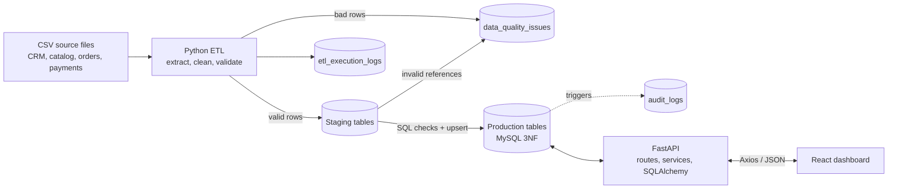
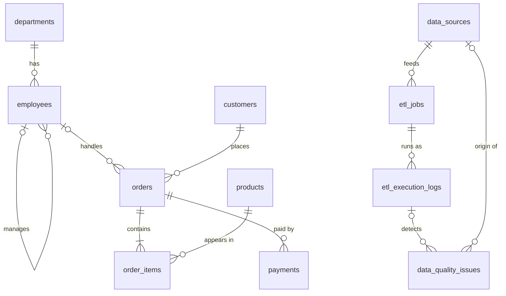

# Enterprise Data Management & Analytics Platform

A data platform built on **MySQL**. It takes operational data from several source systems and runs it through a
**Python/Pandas ETL pipeline** with validation and staging tables. The data lands in a **normalized relational schema**
that is protected by constraints, triggers and stored procedures. A **FastAPI** REST API serves it, and a
**React** dashboard monitors business KPIs, ETL runs, data quality and the audit trail.

> Independent academic project. All data is synthetic (generated by `etl/scripts/generate_sample_data.py`) and
> contains deliberately injected errors so the validation and monitoring features have something real to catch.

---

## Problem statement

Organisations receive data from many systems: CRM, product catalog, order management, payment gateway.
That data arrives with duplicates, missing fields, malformed emails, impossible dates, negative amounts and references
to records that don't exist. If it is loaded as-is, reports become untrustworthy and nobody can say *what* went wrong
or *when* something changed.

## Objectives

1. Design a properly **normalized (3NF) MySQL schema** with keys, constraints and clear relationships.
2. Build an **ETL pipeline** that validates, cleans and loads data through **staging tables**, and never loses bad rows silently.
3. Record **every ETL run** and **every data-quality issue** with severity and resolution status.
4. Keep an **audit trail** of every INSERT/UPDATE/DELETE using triggers.
5. Put critical business rules **inside the database** (procedures, functions, triggers, transactions).
6. Use **indexes** chosen from real query patterns and verify them with `EXPLAIN ANALYZE`.
7. Serve the data through a clean **REST API**, and show it on a simple **dashboard**.

## Features

| Area | What it does |
|---|---|
| Database | 12 core tables + 5 staging tables, PK/FK/UNIQUE/CHECK constraints, 6 views, 3 functions, 5 stored procedures, 19 triggers, 15 secondary indexes |
| SQL | 32 documented queries: JOINs, subqueries, CASE, COALESCE, conditional aggregation, CTEs (incl. recursive), window functions |
| ETL | Extract → clean → validate (13 row rules) → staging → SQL reference checks → idempotent upsert, one transaction per job |
| Data quality | Issues stored with table, record, column, rule, type, severity and status. Five extra cross-table rules run in a stored procedure |
| Audit | Trigger-based audit log with old/new values as JSON, who changed it, and when. The log is append-only |
| Transactions | `sp_record_payment` locks the order row, validates the balance, and commits or rolls back |
| API | ~20 FastAPI endpoints with pagination and filters. MySQL errors are mapped to clean HTTP errors |
| Dashboard | 9 React pages: Dashboard, Customers, Products, Orders, Payments, ETL Monitoring, Data Quality, Analytics, Audit Log |
| Tests | 43 automated tests (pytest) covering the database, the API and the ETL rules |

## Architecture



Full details: [docs/ARCHITECTURE.md](docs/ARCHITECTURE.md)

## Tech stack

| Layer | Technology | Why |
|---|---|---|
| Database | **MySQL 8+** (InnoDB) | ACID transactions, foreign keys, CTEs, window functions, CHECK, JSON |
| ETL | **Python 3.11+, Pandas**, SQLAlchemy, PyMySQL | DataFrames for row validation; SQL for set-based loading |
| Backend | **FastAPI**, SQLAlchemy 2, Pydantic 2, Uvicorn | type-checked request/response models, automatic API docs |
| Frontend | **React 18 + Vite**, Axios, Recharts, React Router | simple SPA, charts with tooltips |
| Testing | pytest, FastAPI TestClient | runs against the real MySQL database |

## Database schema



| Group | Tables |
|---|---|
| Business | `departments`, `employees`, `customers`, `products`, `orders`, `order_items`, `payments` |
| ETL metadata | `data_sources`, `etl_jobs`, `etl_execution_logs` |
| Monitoring | `data_quality_issues`, `audit_logs` |
| Staging | `stg_customers`, `stg_products`, `stg_orders`, `stg_order_items`, `stg_payments` |

Full ER diagram with columns, cardinality and the normalization reasoning: [docs/ER_DIAGRAM.md](docs/ER_DIAGRAM.md)

## ETL workflow

1. **Extract**: read each CSV with every column as text.
2. **Schema check**: if a required column is missing, the whole file is rejected and the job is marked `FAILED`.
3. **Transform**: trim, lower-case emails, title-case names, standardise codes, normalise phone numbers.
4. **Validate**: required values, email format, real dates, no future dates, numeric/integer checks, min/max,
   allowed values, and duplicates (the first occurrence is kept).
5. Rejected rows go to `data_quality_issues` and to `etl/output/rejected/*.csv` with their reasons.
6. **In one transaction**: load staging, resolve business keys to ids, reject rows with invalid references,
   `INSERT ... ON DUPLICATE KEY UPDATE` into production, then update `etl_execution_logs`.
7. Finally, `CALL sp_run_data_quality_checks()` runs the cross-table business rules.

Demo story (`./etl/scripts/load_demo_data.sh`):

| Batch | Result |
|---|---|
| `etl/data/raw/`: initial extract with injected errors | 5 × `PARTIAL_SUCCESS`, e.g. orders: 1,509 read / 1,495 inserted / 14 rejected |
| `etl/data/incremental/`: next-day delta (new rows, price and status changes) | 5 × `SUCCESS`, inserts plus updates, 22 UPDATE audit entries |
| `etl/data/bad_batch/`: customers file without an `email` column | 1 × `FAILED`: "Missing columns: email" |

## API documentation

Interactive Swagger docs are served at **http://localhost:8000/docs** when the backend is running.

| Method | Endpoint | Description |
|---|---|---|
| GET | `/api/health` | API + database connectivity, MySQL version |
| GET | `/api/customers` | paginated list from `vw_customer_360` (`search`, `segment`, `tier`, `sort`) |
| GET | `/api/customers/{id}` | customer + summary from `sp_get_customer_summary` + recent orders |
| GET | `/api/products` | product performance (`search`, `category`) |
| GET | `/api/products/categories` | category list |
| GET | `/api/orders` | from `vw_order_summary` (`search`, `status`, `payment_status`, `customer_id`, `date_from`, `date_to`) |
| GET | `/api/orders/{id}` | order with lines and payments |
| PATCH | `/api/orders/{id}/status` | status change via `sp_update_order_status` (400 on an invalid transition) |
| GET | `/api/payments` | payments (`search`, `status`, `method`, `date_from`, `date_to`) |
| POST | `/api/payments` | record a payment via the transactional `sp_record_payment` |
| GET | `/api/dashboard/summary` | KPIs, orders by status, recent ETL runs |
| GET | `/api/analytics/sales` | monthly sales with running total and growth, by category, by payment method, top products |
| GET | `/api/analytics/customers` | segments, tiers, top customers (RANK), new customers per month |
| GET | `/api/data-quality/issues` | issues (`status`, `severity`, `table`, `issue_type`, `search`) |
| GET | `/api/data-quality/summary` | counts by severity, type, table and rule |
| POST | `/api/data-quality/run-checks` | runs `sp_run_data_quality_checks` |
| PATCH | `/api/data-quality/issues/{id}` | resolve / ignore / reopen an issue |
| GET | `/api/etl/jobs` | jobs with their latest run (`vw_etl_job_status`) |
| GET | `/api/etl/logs` | execution history (`job_id`, `status`) |
| GET | `/api/audit-logs` | audit trail (`table`, `action`, `record_id`, `changed_by`) |

All list endpoints return `{ items, total, page, page_size }` and accept `page` and `page_size` (max 100).

## Setup instructions

### Prerequisites
- MySQL **8.0.16+** (tested on 9.6)
- Python **3.11+** (tested on 3.13)
- Node.js **18+** (tested on 24)

### 1. MySQL setup

Start MySQL, then as an admin user (e.g. `mysql -u root -p`) create the database and a dedicated app user.
Choose your own password:

```sql
CREATE DATABASE enterprise_data_platform CHARACTER SET utf8mb4 COLLATE utf8mb4_0900_ai_ci;
CREATE USER 'edp_app'@'localhost' IDENTIFIED BY 'choose-a-password';
CREATE USER 'edp_app'@'127.0.0.1' IDENTIFIED BY 'choose-a-password';
GRANT ALL PRIVILEGES ON enterprise_data_platform.* TO 'edp_app'@'localhost';
GRANT ALL PRIVILEGES ON enterprise_data_platform.* TO 'edp_app'@'127.0.0.1';
-- MySQL 8 has binary logging on by default. Without this, a non-admin user cannot create
-- stored functions (error 1419). SET GLOBAL lasts until MySQL restarts, which is enough for setup.
SET GLOBAL log_bin_trust_function_creators = 1;
```

### 2. Configure environment variables

```bash
cp .env.example .env
```
Then edit `.env` and set `DB_PASSWORD` (and the other values if yours differ).

### 3. Python environment (ETL + backend)

```bash
python3 -m venv .venv
```
```bash
.venv/bin/pip install -r etl/requirements.txt -r backend/requirements.txt
```
(On Windows use `.venv\Scripts\pip` and `.venv\Scripts\python`.)

### 4. Create the database objects and load the demo data

```bash
./etl/scripts/load_demo_data.sh
```
This runs `database/setup.sh` (schema → indexes → procedures → triggers → views → seed) and then the three ETL
batches. To only rebuild the schema, run `./database/setup.sh`.
Without bash (Windows), run the SQL files in that order with
`mysql -u edp_app -p enterprise_data_platform < database/schema.sql` and so on, then the ETL commands below.

### 5. How to run the ETL

```bash
.venv/bin/python etl/scripts/run_pipeline.py
```
```bash
.venv/bin/python etl/scripts/run_pipeline.py --data-dir etl/data/incremental
```
```bash
.venv/bin/python etl/scripts/run_pipeline.py --data-dir etl/data/bad_batch --jobs load_customers
```
Logs go to `etl/logs/etl.log`. Rejected rows go to `etl/output/rejected/`. To regenerate the CSVs, run
`.venv/bin/python etl/scripts/generate_sample_data.py`.

### 6. How to run the backend

```bash
cd backend && ../.venv/bin/uvicorn app.main:app --reload --port 8000
```
Open http://localhost:8000/docs.

### 7. How to run the frontend

```bash
cd frontend && npm install && npm run dev
```
Open http://localhost:5173. The Vite dev server proxies `/api` to `http://127.0.0.1:8000`.

### 8. Run the tests

```bash
.venv/bin/python -m pytest
```
The tests use the real database from `.env`. Most of them run inside a transaction that is rolled back.
The payment tests commit, then delete their own rows; the audit log keeps a record of that, by design.
Run `./etl/scripts/load_demo_data.sh` again afterwards if you want a perfectly clean demo state.

## Sample screenshots

Run the app and save your own captures into [`docs/screenshots/`](docs/screenshots/README.md):

| Page | File |
|---|---|
| Dashboard | `docs/screenshots/dashboard.png` |
| ETL Monitoring | `docs/screenshots/etl-monitoring.png` |
| Data Quality | `docs/screenshots/data-quality.png` |
| Analytics | `docs/screenshots/analytics.png` |

## Key SQL concepts demonstrated

| Concept | Where |
|---|---|
| SELECT, WHERE, ORDER BY, DISTINCT, LIMIT | `queries.sql` Q1–Q2 |
| Aggregates, GROUP BY, HAVING | Q3–Q5 |
| Date functions | Q6, Q7, `vw_monthly_sales` |
| INNER / LEFT / multi-table / SELF JOIN | Q8–Q12 |
| EXISTS, IN, correlated subquery, derived table | Q13–Q16 |
| CASE, COALESCE, conditional aggregation | Q17–Q19, `vw_order_summary` |
| CTE, recursive CTE | Q20, Q26, `vw_etl_job_status` |
| Window functions: ROW_NUMBER, RANK, DENSE_RANK, NTILE, LAG, SUM OVER | Q21–Q25, analytics API |
| Views | `views.sql` (6 views) |
| Stored procedures, functions, SIGNAL, OUT params | `procedures.sql` |
| Triggers: BEFORE/AFTER, OLD/NEW, JSON audit | `triggers.sql` |
| Transactions, row locking (`FOR UPDATE`), rollback handler | `sp_record_payment`, ETL load step |
| Constraints: PK, FK (RESTRICT/CASCADE/SET NULL), UNIQUE, CHECK, generated column | `schema.sql` |
| Indexes, composite/covering indexes, EXPLAIN / EXPLAIN ANALYZE, invisible indexes | `indexes.sql`, `explain_examples.sql` |
| Upsert (`INSERT ... ON DUPLICATE KEY UPDATE`), `UPDATE ... JOIN` | `etl/scripts/load.py` |

## Project structure

```
enterprise-data-platform/
├── database/            schema, indexes, procedures+functions, triggers, views, seed, queries, EXPLAIN demos, setup.sh
├── etl/
│   ├── data/            raw/, incremental/, bad_batch/ CSV files
│   ├── scripts/         config, extract, transform, validate, load, run_pipeline, generate_sample_data, load_demo_data.sh
│   └── tests/           ETL rule tests
├── backend/
│   ├── app/             main, config, database, models/, schemas/, routes/, services/
│   └── tests/           database + API tests
├── frontend/src/        api/, components/, pages/, utils/
├── docs/                ER_DIAGRAM, ARCHITECTURE, SQL_EXPLANATION, SQL_LEARNING_GUIDE, INTERVIEW_PREPARATION
├── .env.example
├── pytest.ini
└── README.md
```

## Documentation

- [docs/ER_DIAGRAM.md](docs/ER_DIAGRAM.md): ER diagram, relationships, design decisions, normalization
- [docs/ARCHITECTURE.md](docs/ARCHITECTURE.md): layers, ETL flow, staging vs production, backend structure
- [docs/SQL_EXPLANATION.md](docs/SQL_EXPLANATION.md): every query, view, procedure, trigger and index explained, with real EXPLAIN output
- [docs/SQL_LEARNING_GUIDE.md](docs/SQL_LEARNING_GUIDE.md): SQL from SELECT to indexes, with practice questions on this database
- [docs/INTERVIEW_PREPARATION.md](docs/INTERVIEW_PREPARATION.md): project pitch, concept answers, 35 project Q&As

## Future improvements

- Authentication and role-based access (analyst vs data steward)
- Scheduled ETL runs (cron or Airflow) and incremental extraction by timestamp / CDC
- Data-quality thresholds that fail a job automatically (e.g. reject rate > 5%)
- Docker Compose for one-command setup
- Partitioning `orders` by date and a star-schema reporting layer for larger volumes
- Keyset pagination for very large tables
