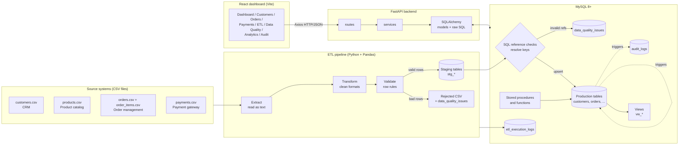
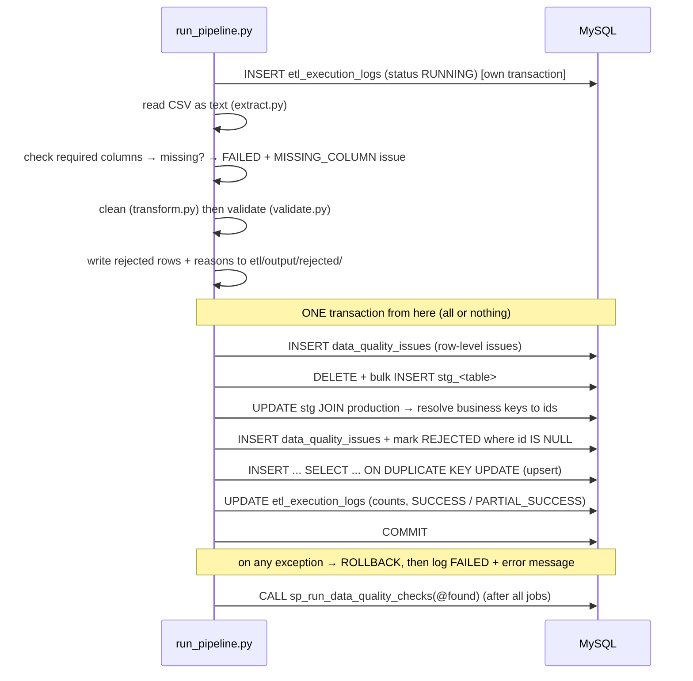

# Architecture

## 1. Big picture



## 2. Layers and responsibilities

| Layer | Folder | Responsibility | Key technologies |
|---|---|---|---|
| Database | `database/` | Schema, constraints, indexes, views, functions, procedures, triggers | MySQL 8+, InnoDB |
| ETL | `etl/scripts/` | Move CSV data into MySQL safely and record everything that happened | Python, Pandas, SQLAlchemy |
| Backend | `backend/app/` | Expose data and operations as a REST API | FastAPI, SQLAlchemy 2, Pydantic 2, PyMySQL |
| Frontend | `frontend/src/` | Dashboard for business and data-quality monitoring | React 18, Vite, Axios, Recharts |

**Where does each rule live?**

| Rule | Where | Why there |
|---|---|---|
| Email format, dates, negative numbers, duplicates in a file | ETL (`validate.py`) | Cheap to check per row before touching the DB; gives a readable reason per row |
| Customer / order / product must exist | SQL in `load.py` (staging → production) | Needs production data, which lives in MySQL |
| Status / segment code lists, amount > 0, unique keys, FKs | MySQL constraints | Last line of defence - applies to *every* writer, not just the ETL |
| Order total = sum of lines | Trigger | Must stay true whatever program changes `order_items` |
| Allowed status transitions, no overpayment | Stored procedures | Business operations that must be atomic (transaction) |
| Cross-table business rules (delivered but unpaid...) | `sp_run_data_quality_checks` | Needs several tables, runs after every load or on demand |

## 3. ETL flow in detail



Jobs run in foreign-key order (taken from `etl_jobs`): customers → products → orders → order_items → payments.

### Source vs staging vs production

| Term | In this project | Purpose |
|---|---|---|
| **Source data** | CSV files in `etl/data/` | Data exactly as other systems deliver it - may contain errors |
| **Transformation** | `transform.py` + key resolution in SQL | Make data consistent: trim, lower-case emails, standardise codes, turn `CUST-1001` into `customer_id = 1` |
| **Validation** | `validate.py` + SQL checks in `load.py` | Decide whether a row is acceptable |
| **Data-quality error** | a row in `data_quality_issues` | A recorded reason why a value/row is wrong, with severity and status |
| **Staging tables** | `stg_*` | Landing zone for one batch: holds validated rows so SQL can check them against production before anything is changed. After a run, `load_status` shows LOADED / REJECTED per row |
| **Production tables** | `customers`, `orders`, ... | Clean, constrained, trusted data used by the API and reports |

### Why resolve keys in staging first? (a real MySQL limitation)

The first version inserted order lines with `INSERT INTO order_items SELECT ... FROM stg_order_items JOIN orders ...`.
MySQL rejected it with **error 1442**: *a trigger cannot modify a table that the statement that fired it is
reading*. The `order_items` trigger updates `orders.order_total`, and the statement was reading `orders`.
The fix: first `UPDATE stg_order_items JOIN orders SET stg.order_id = orders.order_id`, then insert reading
**only** the staging table. This also made the "reject rows whose reference is missing" step one simple
`WHERE order_id IS NULL`.

### Idempotency (safe re-runs)

Loads use `INSERT ... ON DUPLICATE KEY UPDATE` on the business key, so re-running the same file inserts 0 rows
and updates the existing ones. The audit triggers only log an UPDATE if a value actually changed, so a re-run
adds **no** audit noise (verified: 3,281 audit rows before and after re-running the full raw load).

`records_updated` in the log = incoming rows whose key already existed (they were re-applied). Whether a value
really changed is visible in `audit_logs`.

## 4. Backend structure

```
backend/app/
├── main.py          FastAPI app, CORS, router registration
├── config.py        settings from environment variables (.env)
├── database.py      engine (connection pool), session per request, sets @app_user='api'
├── models/          SQLAlchemy ORM classes: one per table + read-only classes for 3 views
├── schemas/         Pydantic models = the exact JSON shape of every request/response
├── routes/          HTTP layer only: parameters, validation, status codes
└── services/        the actual queries / procedure calls / business logic
```

- **routes** never contain SQL; **services** never know about HTTP (except raising 404/400).
- ORM is used for simple filtered lists; **raw SQL** (`text()`) is used for analytics so the window functions
  and views stay readable SQL.
- MySQL errors are translated in `services/common.py`: `SIGNAL` (1644) → 400, duplicate (1062) → 409,
  CHECK / FK violations → 400.

## 5. Frontend structure

```
frontend/src/
├── api/client.js    Axios instance (base URL /api) + error message helper
├── api/useApi.js    tiny data-fetching hook (loading / error / reload)
├── components/      DataTable + Pagination, StatCard, Badge, Select, chart wrappers
├── pages/           one file per page (9 pages)
└── utils/format.js  ₹ / lakh / crore and date formatting
```

In development, Vite proxies `/api` to `http://127.0.0.1:8000`, so the browser talks to one origin.
CORS is still configured in FastAPI (`FRONTEND_ORIGIN`) for deployments where the two run separately.

## 6. Security & configuration choices

- Credentials only in `.env` (git-ignored); `.env.example` documents the variables.
- The app connects as a dedicated MySQL user with rights on **one** database only, not as `root`.
- All SQL from Python uses **bound parameters** (`:id`), never string concatenation of user input → no SQL injection.
- `audit_logs` is append-only (triggers block UPDATE and DELETE).
- Deliberately **not** included (not needed to demonstrate the DBMS goals): authentication, Docker, cloud deployment.
