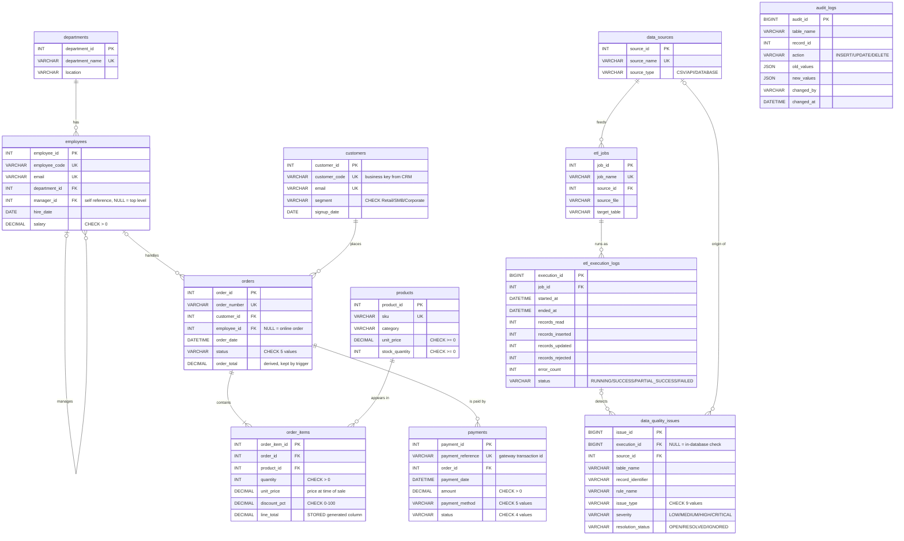

# ER Diagram & Database Design

Database: **MySQL 8+** (developed and tested on MySQL 9.6), engine **InnoDB** (needed for foreign keys and transactions).

## 1. Entity-Relationship diagram

GitHub renders the Mermaid diagram below automatically.
`||--o{` means "one to zero-or-many", `|o--o{` means "zero-or-one to zero-or-many".

`audit_logs` and the five `stg_*` staging tables are intentionally **not connected** by
foreign keys - see section 4.

## 2. Tables at a glance

| Group | Table | One row = | Rows in demo |
|---|---|---|---|
| Business | `departments` | a department | 5 |
| Business | `employees` | a staff member | 20 |
| Business | `customers` | a customer | 204 |
| Business | `products` | a sellable product | 62 |
| Business | `orders` | an order header | 1,525 |
| Business | `order_items` | one product line of an order | 2,868 |
| Business | `payments` | one payment transaction | 1,546 |
| ETL metadata | `data_sources` | a source system | 5 |
| ETL metadata | `etl_jobs` | a job definition | 5 |
| ETL metadata | `etl_execution_logs` | one run of a job | 11 |
| Monitoring | `data_quality_issues` | one detected problem | 116 |
| Monitoring | `audit_logs` | one change to a row | ~3,360 |
| Staging | `stg_customers`, `stg_products`, `stg_orders`, `stg_order_items`, `stg_payments` | one row of the latest batch | (last batch) |

12 core tables + 5 staging tables + 6 views.

## 3. Relationships and cardinality

| Relationship | Cardinality | How it is implemented | ON DELETE |
|---|---|---|---|
| department → employees | 1 : N | `employees.department_id` FK | RESTRICT (can't delete a department that has staff) |
| employee → employees (manager) | 1 : N, optional | `employees.manager_id` FK to the same table (**self-referencing**) | SET NULL |
| customer → orders | 1 : N | `orders.customer_id` FK | RESTRICT (orders are financial records) |
| employee → orders | 1 : N, optional | `orders.employee_id` FK, NULL = online order | SET NULL |
| order ↔ product | **M : N** | resolved by the **junction table** `order_items` (two FKs + `UNIQUE(order_id, product_id)`) | items CASCADE with the order; products RESTRICT |
| order → payments | 1 : N | `payments.order_id` FK (failed attempt + retry, or instalments) | RESTRICT |
| data source → etl jobs | 1 : N | `etl_jobs.source_id` FK | RESTRICT |
| etl job → executions | 1 : N | `etl_execution_logs.job_id` FK | CASCADE |
| execution → data-quality issues | 1 : N, optional | `data_quality_issues.execution_id` FK, NULL for issues found by `sp_run_data_quality_checks` | SET NULL |

**Why different ON DELETE rules?**
- `RESTRICT` where deleting the parent would destroy business history (a customer with orders).
- `CASCADE` where the child has no meaning without the parent (order lines without the order).
- `SET NULL` where the child should survive (an order stays valid if the employee leaves).

## 4. Design decisions (and why)

| Decision | Why |
|---|---|
| **Surrogate keys** (`customer_id INT AUTO_INCREMENT`) + **business keys** (`customer_code UNIQUE`) | Source files only know business codes (`CUST-1001`). Inside the DB, small integer keys make joins and indexes fast and never change if a code is renamed. The ETL translates codes to ids. |
| `DECIMAL(12,2)` for money | `FLOAT`/`DOUBLE` are binary approximations (0.1 + 0.2 ≠ 0.3). Money must be exact. |
| `CHECK` constraints for code lists (status, segment, method) | Enforced by MySQL since 8.0.16. Chosen over `ENUM` because a CHECK list is easier to change and is standard SQL. |
| `order_items.unit_price` stored on each line | It is the price **at the time of sale**. `products.unit_price` changes later (the incremental batch re-prices 5 products) - copying it is *not* duplication. |
| `line_total` as a **STORED generated column** | MySQL computes `ROUND(quantity * unit_price * (1 - discount_pct/100), 2)` itself, so it can never be wrong. |
| `orders.order_total` kept by **triggers** | A deliberate, controlled denormalization: every report needs the order value; triggers keep it in sync with `order_items` no matter which program changes the lines (proved by query Q28 and a test). |
| `audit_logs` has **no foreign key** | It stores changes from 4 different tables (`table_name` + `record_id`), and it must keep the history even after the original row is deleted. A FK would make both impossible. |
| `audit_logs.old_values/new_values` as **JSON** | One audit table for every table, without one column per audited column. |
| Staging tables have **no FKs/unique keys** | Staging must accept the batch as delivered so SQL can *find* bad references and log them, instead of the whole load crashing on the first FK error. |
| `products.category` is a text column, not a separate table | A category has no attributes of its own here (no description, owner...). If it gets some, it should become its own table (that would be the 3NF move). Not creating it avoids a table that adds nothing. |

## 5. Normalization (1NF → 2NF → 3NF) applied to this schema

**1NF - atomic values, no repeating groups.**
An order can contain many products. A non-1NF design would be `orders(order_id, product1, qty1, product2, qty2, ...)`
or a comma-separated `products` column. Here each product line is a separate row in `order_items`.
Each column holds one value (one email, one phone, one date).

**2NF - no partial dependency on part of a composite key.**
`order_items` is identified by the pair `(order_id, product_id)`. A column like `product_name` would depend on
`product_id` **only** (part of the key) → partial dependency → it lives in `products`.
`quantity`, `discount_pct` and the sale-time `unit_price` depend on the **whole** pair, so they stay.
Similarly `customer_name` is not repeated on every order - it depends on `customer_id`, not on `order_id`.

**3NF - no transitive dependency (non-key → non-key).**
In an `employees` table holding `department_name` and `department_location`, those would depend on
`department_id`, which depends on `employee_id` (transitive). So they are moved to `departments`.
Same idea: orders don't store the customer's city; payments don't store the customer id (it is reachable
through `orders`).

**Controlled exceptions (denormalization) and how they stay correct:**
`orders.order_total` (trigger-maintained) and `order_items.line_total` (generated column).
Both are derived values kept correct automatically by the database, not by application code.
